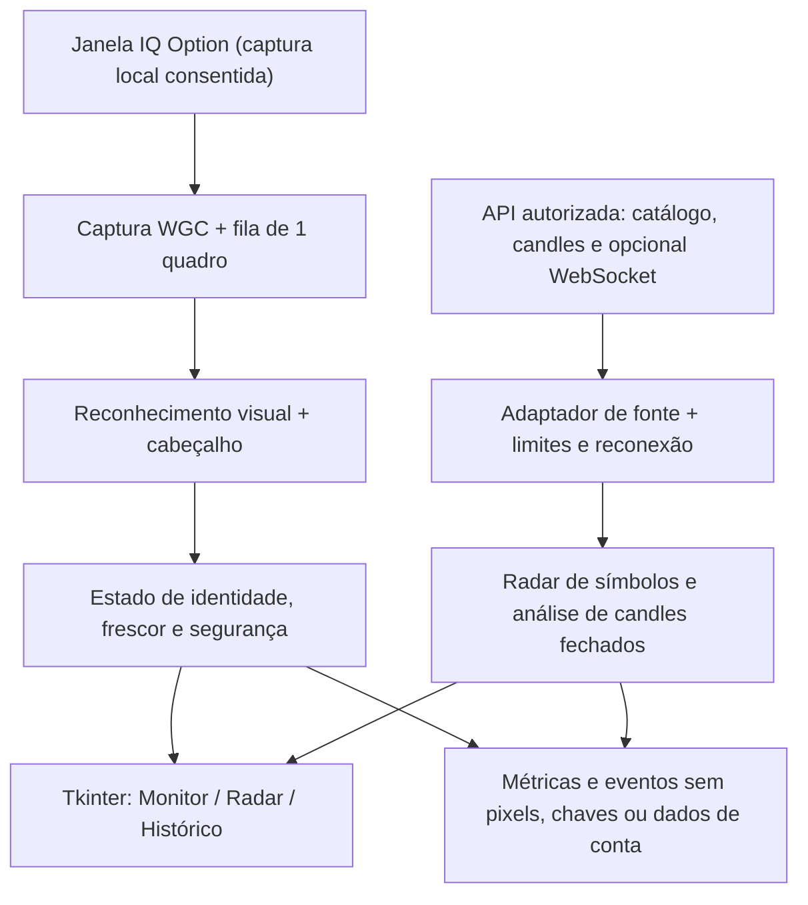

# DS Trader — desenho técnico da arquitetura híbrida

**Status:** abordagem e implementação por etapas aprovadas por Daniel Soliz ("Pode fazer o que vc achar necessário está desse modelo mesmo que vc mandou"). **Data:** 23/10/2026 (São Paulo).
**Repositório:** `Daniel-Soliz/Robo-Das-Binarias`. **Plataforma:** Windows 10/11, Python e Tkinter existentes.

## 1. Intenção e experiência esperada

O DS Trader deve permitir que Daniel selecione uma vez a janela da IQ Option,
continue vendo a leitura visual quando mudar o par ou a criptomoeda mostrada
e, independentemente da tela, consulte um radar de ativos de uma fonte externa
autorizada. O objetivo é **encontrar cenários gráficos a investigar**, com
evidências e frescor dos dados, em uma interface enxuta e responsiva. Não é
um robô executor nem uma previsão garantida.

### Deve fazer

1. **Monitor de janela:** captura local consentida da janela fixada;
   identificação conservadora do ativo, período e condição OTC no cabeçalho,
   quando visíveis e reconhecíveis; invalidação de leituras anteriores na
   troca de ativo; anotação de suporte/resistência e LTA/LTB somente quando
   a imagem for consistente.
2. **Radar separado:** consulta uma lista configurável de pares Forex e cripto
   suportados, com fonte, horário, período, estado da sessão e indicadores
   derivados exclusivamente de candles fechados e datados. Mostra somente
   candidatos cuja base é verificável, inclusive o denominador de pares
   solicitados, recebidos, rejeitados e atrasados.
3. **Triagem:** apresenta `ALTA`, `BAIXA` ou `AGUARDAR` como hipótese
   **descritiva** com confluências e contradições; sem percentual de acerto
   inventado. Rótulos de tela não viram cotações nem sinais operacionais.
4. **Desempenho e robustez:** captura, interpretação do cabeçalho, cálculo,
   consultas externas e Tkinter ficam desacoplados por filas limitadas e
   resultados imutáveis, com medição de latência e estados de falha claros.

### Não deve fazer

- Não enviar ordens, clicar na IQ Option, conectar-se à conta, manipular
  saldo, recuperar credenciais da corretora ou fornecer estratégia como
  garantia de retorno.
- Não afirmar cobertura de **todos** os Forex/criptos: o radar apresenta a
  cobertura real do provedor e do plano, com seleção/priorização explícitas.
- Não confundir os preços da Twelve Data com os da IQ Option, sobretudo OTC.
- Não declarar ciclo M1 visual validado: sem relógio, identidade, preços de
  abertura/fechamento e fonte auditável, o estado permanece `AGUARDAR`.
- Não executar serviços contínuos ou consumir créditos antes da ação
  consciente de iniciar o radar.

## 2. Abordagens consideradas e escolha

| Abordagem | Vantagem | Restrição | Decisão |
| --- | --- | --- | --- |
| Somente captura da IQ Option | Sem chave de dados, leitura da tela local | Não enxerga outros ativos | Descartada |
| Radar externo primeiro | Escala melhor para vários símbolos | Não acompanha a troca na janela | Descartada |
| **Híbrida por etapas** | Janela acompanhada e radar independente, cada qual com procedência | Duas modalidades de dados e validação | **Aprovada pelo usuário** |

**Decisão de implementação proposta, ainda não aprovada:** reaproveitar
`ScreenMonitor`, `WindowTarget`, `LiveScreenTab`, `ForexWatcher`,
`M1Cycle` e `DashboardShell`; isolar novos adaptadores em módulos pequenos,
sem reescrever o armazenamento histórico ou o simulador.

## 3. Componentes e fluxo de dados

### 3.1 Janela e identificação

- O usuário escolhe uma janela/área; a seleção já existente é preservada.
- A captura fixa por `HWND` e `PID` continua em `windows-capture`; o callback
  copia o buffer e retorna, sem OCR ou cálculo no callback.
- Novo reconhecedor lê um **recorte de cabeçalho configurável**, não a área
  de candles: par Forex ou símbolo de cripto, período M1/M5/M15 e marcador
  OTC. Reutilizar as validações do OCR legado somente após isolá-las das
  dependências pesadas e ampliar seu vocabulário. A identificação é opcional
  e pode ficar `DESCONHECIDO`; jamais substituir por símbolo presumido.
- A comparação de identidade usa observações temporais estáveis antes de
  confirmar um símbolo. Em divergência, cabeçalho ilegível, ROI inválida,
  período não identificado ou perda de janela: **limpar a hipótese anterior
  imediatamente** e exibir `AGUARDAR` até recuperar a confiança.
- Cada quadro recebe `captured_monotonic`, identificador da geração da
  janela/ativo e tempo de análise; respostas de gerações antigas são
  descartadas. OCR tem frequência limitada e nunca trava a UI.
- `visual_outlook` continua educacional; pixels isolados não alimentam
  `M1History(source_kind=TIMESTAMPED_QUOTES)`.

### 3.2 Radar Forex e cripto

- **Fonte inicial:** manter Twelve Data como o primeiro adaptador, porque
  o aplicativo já suporta seu REST para nove pares Forex. Expandir o
  catálogo **somente conforme acesso real** (`forex_pairs`, catálogo de
  criptos e metadados de símbolos). Não codificar uma promessa de universo
  completo nem tratar ausência de assinatura como dado vazio/mercado parado.
- REST fornece candles com UTC/identidade/verificação de fechamento; um
  WebSocket poderá atualizar preço/frescor **somente se permitido pelo
  plano**. Tick de WebSocket não é, por si, comprovação de candle fechado.
- Trabalhar com **lista configurável de favoritos** e limite de assinaturas
  calculado pelo crédito permitido. A expansão para cobertura ampla é etapa
  posterior e necessita teste com conta/plano da fonte. Se não houver chave
  configurada, o radar apresenta `NÃO CONECTADO`, nunca valores fictícios.
- Rate limiter por fonte, timeout, cancelamento, backoff com jitter,
  tratamento de HTTP 429 e desconexão; manter o último registro apenas
  como **histórico atrasado**, nunca como atualização corrente.
- Apenas candles OHLC fechados, sem duplicatas, sem horários futuros,
  com séries contínuas e pelo menos a amostra mínima exigida. Alertas
  usam tendência SMA9/SMA21, suporte/resistência por pivôs, movimento,
  volatilidade e confluência; evidências contraditórias geram `AGUARDAR`.
- Cada oportunidade carrega `fonte`, `símbolo`, `periodo`,
  `ultimo_fechamento_utc`, `atraso`, `motivos`, `alertas` e `status`.
- **Não cruzar** candles externos com captura IQ como se fossem o mesmo
  mercado, período, plataforma ou preço; OTC não é mapeado automaticamente.

### 3.3 Ciclo de avaliação M1

- Preservar os guardas já implementados em `M1Cycle`.
- O ciclo auditável só aceita adaptador futuro de quotes temporizadas,
  com identidade, relógio, candle fechado, abertura e vencimento
  **comprovados pela mesma fonte**. Sem esses dados o radar pode oferecer
  análise descritiva, mas não computar acerto de previsão.
- Troca de par, atraso acima do limite, perda de conectividade ou conflito
  de período cancela pendências; nunca valida entrada retroativamente.

### 3.4 Referência externa day-trader-skill

O repositório `Jakeschincariol/day-trader-skill` é orientado a ações dos EUA.
Aproveitar **conceitos** de scan incremental, contagem de falhas e lista
de observação; não incorporar diretamente o scanner Nasdaq/Yahoo como se
fosse Forex/cripto. Preservar o instalador opcional de skills Claude Code
existente. Não incorporar `trader-broker` nem componentes de execução
de ordens. Caso código MIT seja efetivamente copiado, reter licença e crédito.

## 4. Interface proposta — janela única

- **Topo compacto:** DS Trader, ativo identificado, período, fonte e estado
  (`CONECTADO`, `AGUARDAR`, `ATRASADO`, `SEM FONTE`).
- **Centro esquerdo, maior área:** miniatura do gráfico local com marcações
  relativas de suporte/resistência e linhas de tendência quando legíveis.
- **Centro direito:** cartão de hipótese visual (`ALTA`, `BAIXA` ou
  `AGUARDAR`) com até três evidências, contradições e motivo do bloqueio.
- **Abaixo:** radar de favoritos, com símbolo, mercado, período,
  atualização, direção descritiva, evidências resumidas e estado; filtros
  `Forex`, `Cripto`, `Atualizados`, `Aguardando`.
- **Navegação sem excesso:** `Monitor`, `Radar`, `Histórico`; simulador,
  relatórios e configurações preservados em `Ferramentas`.
- Detalhes longos ficam recolhidos. Sem rolagem para ver o estado principal.
  Animações só transições leves; nenhum efeito ocupa a thread da UI.
- Nunca confundir o destaque direcional experimental com um sinal
  confirmado. Dados de outras fontes exibem nome/horário explicitamente.

## 5. Segurança e compatibilidade

- Nenhuma ordem financeira; API somente leitura; sem login/segredo da IQ.
- Chaves da Twelve Data permanecem na memória durante a sessão e não entram
  em logs, relatórios, screenshots persistidos ou arquivos de configuração.
- Nenhum dado do usuário apagado ou migrado sem cópia recuperável;
  preservar esquema SQLite, configurações, exportações e APIs de UI/CLI.
- Não instalar silenciosamente bibliotecas OCR ou pedir credenciais no chat.
  Se OCR for habilitado, verificar empacotamento, licença e configuração
  no Windows antes de declarar suporte.
- Falhas de fonte são expostas com ação de recuperação; logs estruturados
  sem material sensível.

## 6. Plano de entrega em etapas (para detalhar após aprovação)

1. **Base e testes de regressão:** congelar baseline do projeto, testes
   sobre troca de identidade, fila/latência, dados antigos e fail-closed;
   manter suíte atual verde.
2. **Troca de ativo na janela:** introduzir identificação de cabeçalho,
   geração de sessão, invalidação de estado, tempo de leitura e testes com
   imagens reais consentidas e sintéticas. Falha de OCR implica AGUARDAR.
3. **Radar com fonte real:** separar catálogo, conectores, agendador,
   análise e modelos de resultado; ligar primeiro a pares suportados
   pelo plano atual. Testes offline com respostas capturadas e, com chave
   local autorizada, integração real verificada.
4. **Dashboard híbrido:** reduzir ruído e conectar as duas fontes com
   status e histórico; testes de navegação/responsividade.
5. **Validação Windows e release:** rodar build, smoke test, instalação
   real, alternância de ativos e benchmarks end-to-end; publicar somente
   após validação e autorização de lançamento.

## 7. Critérios mensuráveis de aceite

- **Baseline observado agora:** 127 testes aprovados, 1 ignorado por
  depender de `EnumWindows` no Windows. Processamento visual isolado:
  mediana 11,08 ms; P95 16,18 ms em 100 execuções sobre uma imagem
  gravada; 31 corpos identificados; hipótese `INDEFINIDO`.
- Toda troca de ativo limpa o cenário anterior **antes** do primeiro
  resultado do novo ativo; nenhuma atualização atrasada reintroduz dados
  do ativo anterior. Testar perdas e falsos positivos.
- Sem janela, símbolo, período, fonte atualizada, candle fechado ou
  sincronização comprovada: informar precisamente o motivo e `AGUARDAR`.
- Durante análise e rede lenta, UI aceita comandos e continua repintando;
  atraso de cada etapa é medido em testes reais, sem prometer latência zero.
- Scan de N símbolos informa `N solicitados / recebidos / falhos /
  atrasados / não suportados`; sem inventar dados para preencher lacunas.
- Benchmark de CPU/memória e fila com 30 min de execução no Windows;
  cenário de troca de par, internet cortada, 429 e janela minimizada.
- Sem Windows físico e acesso de teste ao provedor, marcar explicitamente
  como **pendentes** integração nativa, feed ao vivo, OTC e instalador.
- Não regredir os testes atuais, preservar instalação, dados e configurações.

## 8. Decisões que ficam com a implementação

- Nomes finais das classes/adaptadores e eventos imutáveis.
- Biblioteca OCR local após investigação de compatibilidade, custo e
  empacotamento; pode ser desativada por falha sem bloquear a captura.
- Limiares conservadores de qualidade geométrica e janela temporal,
  derivados de fixtures e testes, nunca calibrados para produzir sinal.
- Ordem de migração da UI e estratégia de teste unitário por módulo.

## 9. Dependências e bloqueadores conhecidos

- **Para provar a identificação visual:** prints/gravações da IQ Option
  com símbolos Forex/cripto, diferentes períodos e alteração de ativo,
  consentidos por Daniel. Não gravar dados de conta desnecessariamente.
- **Para provar radar em tempo real:** chave pessoal de provedor e limites
  de plano conhecidos; configurar localmente, sem enviar no chat.
- **Para provar instalador:** Windows 10/11 com ambiente de teste e
  permissão para executar aplicativo, WGC e Inno Setup.

### Confirmações de produto identificadas na revisão independente

1. **Primeira cobertura do radar:** propõe-se iniciar com favoritos
   configuráveis, informando exatamente quais símbolos foram consultados,
   e ampliar gradualmente aos demais símbolos disponíveis no plano.
   Essa entrega parcial precisa ser aceita porque o desejo de observar
   todo o universo de Forex/cripto não cabe em uma garantia de cobertura
   irrestrita sem fornecedor e orçamento definidos.
2. **Condição da fonte externa:** propõe-se reutilizar Twelve Data,
   com uma chave informada **somente no próprio aplicativo** e funcionalidades
   ligadas apenas quando o plano autorizar. Sem chave/plano, a parte visual
   do app continua funcional, mas o radar mostra `NÃO CONECTADO` e os testes
   com cotações ao vivo permanecem pendentes, sem simulação disfarçada.

Daniel autorizou a implementação por etapas com liberdade para decidir
os detalhes técnicos. A entrega incremental de favoritos e uso de fonte
externa conforme o plano foram adotados como decisões do projeto; se não
houver chave local, o radar ficará desconectado e a validação ao vivo
continuará pendente.

**Plano resultante:** `docs/superpowers/plans/2026-10-23-ds-trader-hybrid-phase1.md`.
